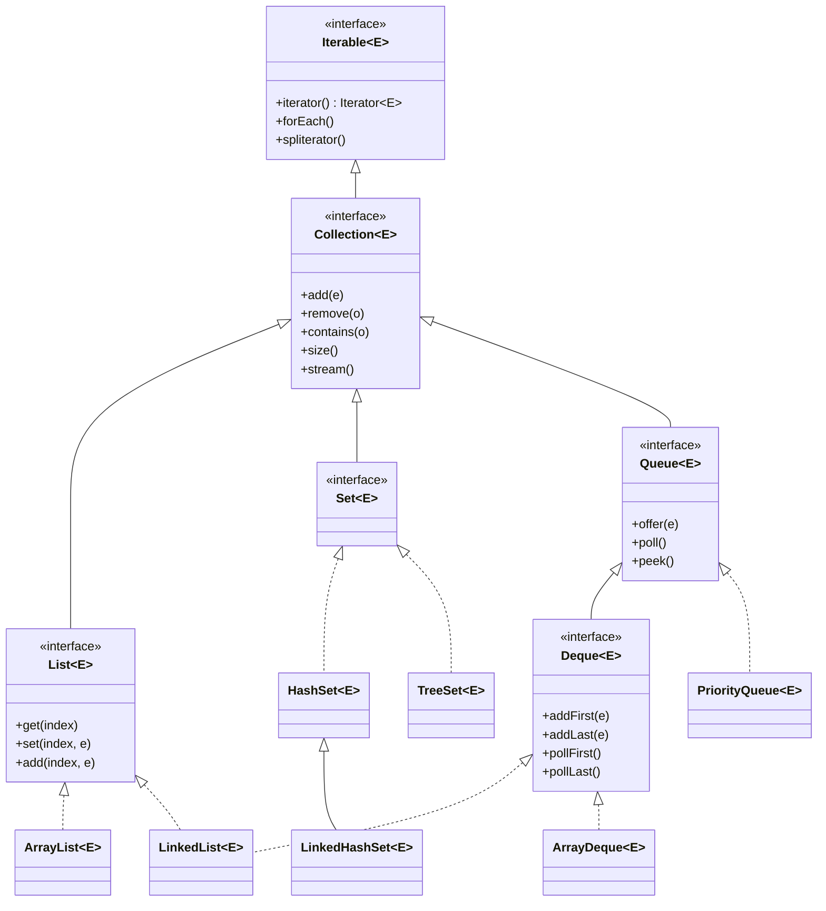
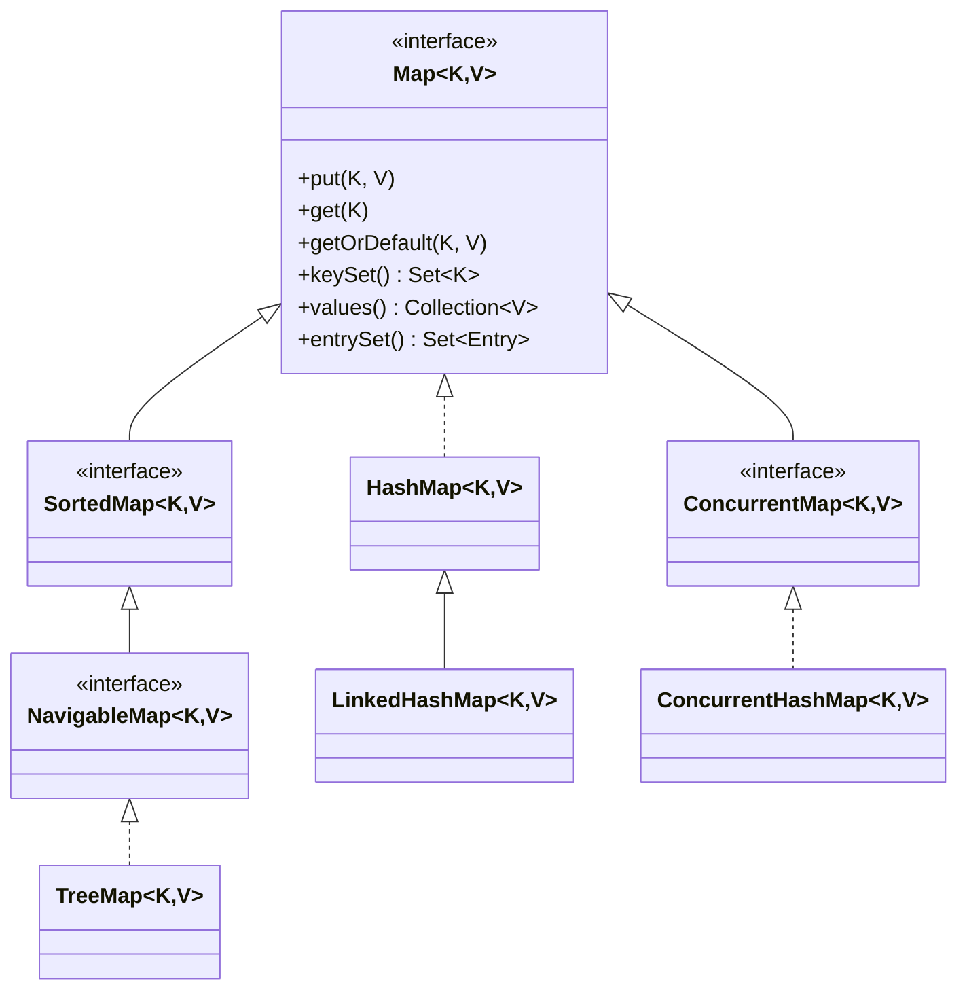

# ☕ The Google Senior Engineer's Master Guide to Java Collections Framework (JCF)

> **Welcome to the team!** As an L3/fresher at Google, writing code that *just works* isn't enough. We build distributed systems serving billions of requests per second. At this scale, choosing an `ArrayList` vs. a `LinkedList`, or misunderstanding how `HashMap` handles collisions, directly impacts latency (p99), memory footprint, GC pause times, and cache locality.
>
> Let's break down the **Java Collections Framework (JCF)** from first principles to memory layouts and JVM internals.

---

## 📑 Table of Contents
1. [Architectural Overview & Core Hierarchy](#1-architectural-overview--core-hierarchy)
2. [Root Interfaces & Core Contract Methods](#2-root-interfaces--core-contract-methods)
3. [The `List` Interface & Internals](#3-the-list-interface--internals)
   - `ArrayList` (Growth factor, `System.arraycopy`, CPU cache locality)
   - `LinkedList` (Doubly-linked nodes, pointer overhead, cache misses)
   - `Vector` & `CopyOnWriteArrayList`
4. [The `Set` Interface & Internals](#4-the-set-interface--internals)
   - `HashSet` (Backing map, dummy value `PRESENT`)
   - `LinkedHashSet` (Doubly-linked buckets + iteration order)
   - `TreeSet` (Red-Black tree backing, `Comparable` vs `Comparator`)
5. [The `Queue` & `Deque` Interfaces & Internals](#5-the-queue--deque-interfaces--internals)
   - `PriorityQueue` (Min-heap array representation, sift-up/sift-down)
   - `ArrayDeque` (Circular array buffer, head/tail bit masking)
6. [The `Map` Hierarchy & Deep Internals](#6-the-map-hierarchy--deep-internals)
   - `HashMap` Deep Dive (Buckets, Hash spread, Collision resolution, Treeification)
   - `LinkedHashMap` (Access-order vs Insertion-order, LRU Cache implementation)
   - `TreeMap` (Red-Black self-balancing tree)
   - `ConcurrentHashMap` (CAS, synchronized bucket heads, TreeBins)
7. [Complexity Cheat Sheet & Memory Profiling](#7-complexity-cheat-sheet--memory-profiling)
8. [Production Gotchas & Senior Engineer Rules of Thumb](#8-production-gotchas--senior-engineer-rules-of-thumb)

---

## 1. Architectural Overview & Core Hierarchy

In Java, data structures are split cleanly into two primary trees:
1. **`java.util.Collection`**: For groups of individual elements (`List`, `Set`, `Queue`, `Deque`).
2. **`java.util.Map`**: For key-value pairs (maps do *not* implement `Collection` because key-value semantics are fundamentally distinct).



### Map Hierarchy (Independent Tree)



---

## 2. Root Interfaces & Core Contract Methods

### The `Iterable<T>` and `Collection<E>` Contracts
Every collection inherits from `Iterable<T>`, meaning it can be used in `for-each` loops and produces an `Iterator<T>`.

```java
public interface Collection<E> extends Iterable<E> {
    int size();
    boolean isEmpty();
    boolean contains(Object o);
    boolean add(E e);
    boolean remove(Object o);
    boolean containsAll(Collection<?> c);
    boolean addAll(Collection<? extends E> c);
    boolean removeAll(Collection<?> c);
    boolean retainAll(Collection<?> c); // Set intersection
    void clear();
    Object[] toArray();
    <T> T[] toArray(T[] a);
    default Stream<E> stream() { ... }
}
```

> **The `equals()` and `hashCode()` Contract:**
> - If `o1.equals(o2) == true`, then `o1.hashCode() == o2.hashCode()` **MUST** be true.
> - If `hashCode()` is equal, the objects are **NOT** necessarily equal (hash collision).
> - If you override `equals()`, you **MUST** override `hashCode()`. Failing to do this breaks `HashMap`, `HashSet`, and `ConcurrentHashMap`.

---

## 3. The `List` Interface & Internals

An ordered sequence with index-based random access. Elements may be duplicated and `null` is generally allowed.

### A. `ArrayList` Deep Dive
- **Backing store:** Simple array: `transient Object[] elementData`.
- **Default capacity:** `10` (allocated lazily upon the first `.add()`).
- **Growth mechanism:**
  ```java
  // In OpenJDK: newCapacity = oldCapacity + (oldCapacity >> 1)  -> ~1.5x growth
  int newCapacity = ArraysSupport.newLength(oldCapacity,
          minCapacity - oldCapacity, /* minimum growth */
          oldCapacity >> 1           /* preferred growth */);
  ```
- **Copying elements:** Uses JVM intrinsic `System.arraycopy()` (native memory blit).
- **CPU Cache Locality:** **Exceptional.** Because elements sit in contiguous memory lines, hardware CPU prefetchers pull surrounding elements straight into L1/L2 cache.

```
ArrayList In Memory (Contiguous array of object pointers):
+----+----+----+----+----+----+----+----+
| Ref| Ref| Ref| Ref| Ref| null null null |   (Capacity = 8, Size = 5)
+----+----+----+----+----+----+----+----+
  0    1    2    3    4    5    6    7
```

### B. `LinkedList` Deep Dive
- **Backing store:** Doubly-linked list with `Node<E>` objects:
  ```java
  private static class Node<E> {
      E item;
      Node<E> next;
      Node<E> prev;
  }
  ```
- **Memory Overhead:** On a 64-bit JVM (with Compressed OOPs enabled):
  - Object header: 12 bytes + 4 bytes padding = 16 bytes.
  - 3 references (`item`, `next`, `prev`): 4 * 3 = 12 bytes.
  - Total per node: **24-32 bytes overhead per element**, not counting the actual payload!
- **Cache Misses:** Nodes are scattered across the JVM heap. Traversing triggers cache line misses.

> **Production Rule:** Almost **never** use `LinkedList` in production at scale. Even for insertions in the middle, finding the index takes O(N) pointer chasing. If you need a queue or stack, use `ArrayDeque`. If you need a list, use `ArrayList`.

### Code Example: `List` Implementations & Methods

```java
import java.util.*;

public class ListDemo {
    public static void main(String[] args) {
        // PREFER: Specify initial capacity if approximate size is known!
        // Avoids multiple expensive array reallocations and copies.
        List<String> services = new ArrayList<>(16);

        // --- Core List Methods ---
        services.add("BigQuery");               // Append to tail: O(1) amortized
        services.add("Spanner");
        services.add(1, "Cloud Storage");       // Insert at index: O(N) due to right shift

        // Fast random access: O(1)
        String primary = services.get(0); 

        // Modifying by index: O(1)
        services.set(2, "Cloud Spanner");

        // Search: O(N) linear scan
        boolean exists = services.contains("BigQuery");
        int index = services.indexOf("BigQuery");

        // Iteration via ListIterator (allows bidirectional traversal & safe in-place mutations)
        ListIterator<String> listIt = services.listIterator();
        while (listIt.hasNext()) {
            String svc = listIt.next();
            if (svc.equals("Cloud Storage")) {
                listIt.set("GCS (Google Cloud Storage)"); // Replace during iteration
            }
        }

        // SubList: Creates a VIEW, NOT a copy!
        // Mutations on subList mutate the parent backing array.
        List<String> sub = services.subList(0, 2);
        
        System.out.println("ArrayList: " + services);
    }
}
```

---

## 4. The `Set` Interface & Internals

A collection that contains **no duplicate elements**. Models the mathematical set abstraction.

### A. `HashSet`
- **Internal Secret:** A `HashSet` is literally just an instance of `HashMap` under the hood!
  ```java
  private transient HashMap<E,Object> map;
  private static final Object PRESENT = new Object(); // Dummy placeholder

  public boolean add(E e) {
      return map.put(e, PRESENT) == null;
  }
  ```
- **Ordering:** Completely unordered. Iteration order changes across resizes.

### B. `LinkedHashSet`
- Extends `HashSet`. Backed by `LinkedHashMap`.
- Maintains a **doubly-linked list across all buckets**.
- **Iteration Order:** Predictable FIFO insertion order (or access order).
- **Cost:** Slightly higher memory footprint for node pointers.

### C. `TreeSet`
- Backed by a `NavigableMap` (`TreeMap`), which is a **Red-Black Tree** (self-balancing BST).
- Guarantees O(log N) time for `add`, `remove`, `contains`.
- Requires elements to implement `Comparable<T>` or pass a `Comparator<T>`.

### Code Example: `Set` Implementations & Methods

```java
import java.util.*;

public class SetDemo {
    public static void main(String[] args) {
        // 1. HashSet: O(1) avg lookup, no ordering
        Set<String> clusters = new HashSet<>();
        clusters.add("us-central1");
        clusters.add("europe-west1");
        clusters.add("asia-east1");
        clusters.add("us-central1"); // Duplicate ignored; returns false

        // 2. LinkedHashSet: O(1) lookup, preserves insertion order
        Set<String> orderedClusters = new LinkedHashSet<>();
        orderedClusters.add("primary");
        orderedClusters.add("secondary");
        orderedClusters.add("canary");

        // 3. TreeSet: O(log N) lookup, sorted naturally or via Comparator
        NavigableSet<Integer> portNumbers = new TreeSet<>();
        portNumbers.add(8080);
        portNumbers.add(443);
        portNumbers.add(22);
        portNumbers.add(9092);

        // NavigableSet specific range operations:
        int highest = portNumbers.last();                 // 9092
        int lowest = portNumbers.first();                 // 22
        Integer floor = portNumbers.floor(500);           // Greatest element <= 500 -> 443
        Integer ceiling = portNumbers.ceiling(500);       // Smallest element >= 500 -> 8080
        NavigableSet<Integer> subset = portNumbers.subSet(100, true, 5000, true);

        System.out.println("Sorted Ports: " + portNumbers);
        System.out.println("Floor of 500: " + floor);
    }
}
```

---

## 5. The `Queue` & `Deque` Interfaces & Internals

Used to hold elements prior to processing. Supports FIFO, LIFO (stack), or priority-based ordering.

```
Queue Operations Summary:
+---------+--------------------+---------------------+
| Action  | Throws Exception   | Returns Special Val |
+---------+--------------------+---------------------+
| Insert  | add(e)             | offer(e) -> boolean |
| Remove  | remove()           | poll() -> null      |
| Examine | element()          | peek() -> null      |
+---------+--------------------+---------------------+
```

### A. `PriorityQueue` (Min-Heap Internals)
- Backed by a flat array `Object[] queue` representing a **complete binary tree**.
- For any node at index $k$:
  - Left child = $2k + 1$
  - Right child = $2k + 2$
  - Parent = $(k - 1) / 2$
- **Offer (Insertion):** Places element at end of array and performs **Sift-Up** (O(log N)).
- **Poll (Removal):** Swaps root with last element, deletes last element, performs **Sift-Down** on root (O(log N)).
- **Peek:** Direct access to `queue[0]` in O(1).

```
PriorityQueue Min-Heap in Memory:
Tree Representation:          Array Representation:
        [10]                  Index:  0   1   2   3   4
       /    \                 Val:  [10, 15, 20, 30, 40]
     [15]   [20]
     /  \
   [30] [40]
```

### B. `ArrayDeque` (Double-Ended Queue Internals)
- High-performance circular buffer backed by `Object[] elements`.
- Maintains `head` and `tail` pointers.
- Capacity is always a **power of 2**, allowing pointer wrap-around via fast bitwise masking:
  ```java
  head = (head - 1) & (elements.length - 1);
  tail = (tail + 1) & (elements.length - 1);
  ```
- **Senior Tip:** Replaces both legacy `Stack` (which inherits from slow, synchronized `Vector`) and `LinkedList` for queues.

### Code Example: `Queue` and `Deque`

```java
import java.util.*;

public class QueueDequeDemo {
    public static void main(String[] args) {
        // 1. PriorityQueue: Custom comparator for Max-Heap
        PriorityQueue<Integer> latencyQueue = new PriorityQueue<>(Comparator.reverseOrder());
        latencyQueue.offer(120); // 120ms
        latencyQueue.offer(15);  // 15ms
        latencyQueue.offer(300); // 300ms

        // Polling returns elements in prioritized order
        while (!latencyQueue.isEmpty()) {
            System.out.println("Processing latency: " + latencyQueue.poll() + "ms"); // 300, 120, 15
        }

        // 2. ArrayDeque: Used as a fast LIFO Stack
        Deque<String> traceStack = new ArrayDeque<>();
        traceStack.push("RPC: AuthServer");       // Equivalent to addFirst()
        traceStack.push("RPC: DatabaseRead");
        traceStack.push("RPC: CacheLookup");

        System.out.println("Current Frame: " + traceStack.peek()); // RPC: CacheLookup
        while (!traceStack.isEmpty()) {
            System.out.println("Popped: " + traceStack.pop());     // LIFO: CacheLookup -> DatabaseRead -> AuthServer
        }

        // 3. ArrayDeque: Used as a FIFO Queue
        Deque<String> taskQueue = new ArrayDeque<>();
        taskQueue.offerLast("Task-1");
        taskQueue.offerLast("Task-2");
        System.out.println("Next task: " + taskQueue.pollFirst()); // Task-1
    }
}
```

---

## 6. The `Map` Hierarchy & Deep Internals

### The Holy Grail: `HashMap` Internals (Java 8+)

`HashMap` is arguably the most asked topic in Google system and language interviews.

```
HashMap Architecture:
Index:
 [0]  -> Node(K1,V1) -> Node(K2,V2) -> null       (Linked List bucket)
 [1]  -> null
 [2]  -> TreeNode(Root of Red-Black Tree)         (Treeified bucket: size >= 8)
 [3]  -> Node(K3,V3) -> null
 ...
[15]  -> null
```

#### Step 1: Hash Spread Function
`key.hashCode()` returns an arbitrary 32-bit signed int. If we just did modulo with the table length, we'd lose high-bit entropy. Java mixes high bits down:
```java
static final int hash(Object key) {
    int h;
    return (key == null) ? 0 : (h = key.hashCode()) ^ (h >>> 16);
}
```

#### Step 2: Bucket Index Calculation
Because bucket array length $N$ is always a power of 2, modulo `hash % N` is optimized to bitwise AND:
```java
index = (n - 1) & hash;
```

#### Step 3: Collision Resolution & Treeification
1. When two distinct keys hash to the same bucket index, they are stored as a singly linked list (`Node<K,V>`).
2. **Treeification Threshold (`TREEIFY_THRESHOLD = 8`):** If a single bucket reaches **8 nodes** and the total table capacity is at least **64** (`MIN_TREEIFY_CAPACITY`), the bucket converts from a linked list to a **Red-Black Tree** (`TreeNode<K,V>`).
   - Worst-case lookup drops from $O(N)$ to $O(\log N)$, preventing Hash Collision Denial of Service (DoS) attacks.
3. **Untreeify Threshold (`UNTREEIFY_THRESHOLD = 6`):** When elements are removed and the tree shrinks to 6, it converts back to a linked list to save memory.

#### Step 4: Resizing (Rehashing)
- Initial default capacity: **16**. Default load factor: **0.75**.
- Resizing threshold = `capacity * loadFactor` ($16 \times 0.75 = 12$).
- When size exceeds threshold, table doubles ($16 \to 32 \to 64$).
- **The Power-of-2 Bit Trick:** During resize, a node either stays at index `i` or moves to `i + oldCap`. No need to recompute hash! Simply check `(hash & oldCap) == 0`.

### B. `LinkedHashMap` & Building an LRU Cache
`LinkedHashMap` maintains a doubly-linked list running through all its entries. By passing `accessOrder = true`, it orders entries based on **recent access** rather than insertion.

```java
import java.util.*;

// Cleanest thread-unsafe LRU Cache implementation in Java
public class LRUCache<K, V> extends LinkedHashMap<K, V> {
    private final int maxCapacity;

    public LRUCache(int capacity) {
        // initialCapacity, loadFactor = 0.75f, accessOrder = true
        super(capacity, 0.75f, true);
        this.maxCapacity = capacity;
    }

    // Hook called by put() and putVal()
    @Override
    protected boolean removeEldestEntry(Map.Entry<K, V> eldest) {
        return size() > maxCapacity; // Evicts oldest entry when true
    }

    public static void main(String[] args) {
        LRUCache<String, String> cache = new LRUCache<>(3);
        cache.put("A", "TokenA");
        cache.put("B", "TokenB");
        cache.put("C", "TokenC");
        cache.get("A"); // A is now most-recently used; order: B, C, A

        cache.put("D", "TokenD"); // Exceeds capacity! B is eldest -> evicted

        System.out.println("LRU Cache keys: " + cache.keySet()); // [C, A, D]
    }
}
```

### C. `ConcurrentHashMap` Internals (Java 8+)
- **No global lock:** Unlike legacy `Hashtable` (single monitor lock) or Java 7 `Segment` locks.
- **Lock-Free Reads:** `get()` uses volatile pointer reads without locking ($O(1)$ lock-free).
- **Fine-Grained Writes:**
  - If the target bucket is empty: uses **CAS (Compare-And-Swap)** to insert without locks.
  - If the bucket has collisions: synchronizes **only on the first Node (bucket head)** of that specific bucket chain (`synchronized(f)`).

---

## 7. Complexity Cheat Sheet & Memory Profiling

| Collection | Add / Insert | Remove | Get by Index / Key | Contains | Space Overhead per Element |
| :--- | :--- | :--- | :--- | :--- | :--- |
| **`ArrayList`** | $O(1)$ amortized | $O(N)$ | $O(1)$ | $O(N)$ | Minimal (just 4/8-byte pointer) |
| **`LinkedList`** | $O(1)$ (head/tail) | $O(1)$ (known node) | $O(N)$ | $O(N)$ | **High** (~24 bytes per node) |
| **`ArrayDeque`** | $O(1)$ amortized | $O(1)$ | $N/A$ | $O(N)$ | Minimal (flat array) |
| **`HashSet`** | $O(1)$ avg | $O(1)$ avg | $N/A$ | $O(1)$ avg | High (backing `HashMap.Node`) |
| **`TreeSet`** | $O(\log N)$ | $O(\log N)$ | $N/A$ | $O(\log N)$ | High (tree pointers + color) |
| **`HashMap`** | $O(1)$ avg, $O(\log N)$ worst | $O(1)$ avg | $O(1)$ avg | $O(1)$ avg | High (`Node` + table array) |
| **`TreeMap`** | $O(\log N)$ | $O(\log N)$ | $O(\log N)$ | $O(\log N)$ | High (`left`, `right`, `parent`, color) |

---

## 8. Production Gotchas & Senior Engineer Rules of Thumb

### 1. The `ConcurrentModificationException` Trap
Never mutate a collection while iterating it using a raw iterator or enhanced `for` loop:
```java
// ❌ WRONG: Throws ConcurrentModificationException
for (String item : list) {
    if (condition(item)) list.remove(item);
}

// ✅ CORRECT: Use Iterator.remove()
Iterator<String> it = list.iterator();
while (it.hasNext()) {
    if (condition(it.next())) it.remove();
}

// ✅ MODERN (Java 8+): Use removeIf()
list.removeIf(item -> condition(item));
```

### 2. Always Pre-Size Collections
When fetching $100,000$ records from a database or remote microservice, sizing your map/list up-front prevents repeated reallocation and GC churn:
```java
// ❌ WRONG: Resizes and copies 14 times
List<Record> list = new ArrayList<>();

// ✅ CORRECT: Zero resizes
List<Record> list = new ArrayList<>(100_000);

// For HashMap: to hold N items without resizing, capacity = ceil(N / 0.75) + 1
// In Guava: Maps.newHashMapWithExpectedSize(100_000);
```

### 3. Immutable Collections (`List.of`, `Set.of`, `Map.of`)
Introduced in Java 9:
- Truly unmodifiable (throws `UnsupportedOperationException`).
- Highly memory-optimized (compact representation, does not allocate arrays for small counts).
- Disallow `null` strictly.

```java
List<String> unmodifiable = List.of("prod-east", "prod-west");
// unmodifiable.add("canary"); // Crash at runtime!
```
